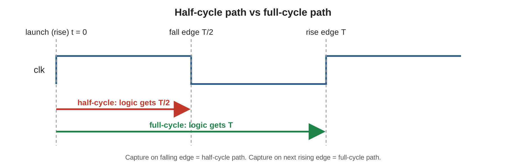

# Half-Cycle Path Timing: Find It in `report_timing` and Fix It

**Tool:** Synopsys Design Compiler | **Language:** Verilog, Tcl, SDC

## Objective
Recognise a **half-cycle path** from a `report_timing` report, understand why it fails, change the design so the path becomes a full-cycle path, and confirm timing is correct.

## Half cycle vs. full cycle


A flop launching on the rising edge and a flop capturing on the **falling** edge leave only **T/2** for the logic between them. The same logic captured on the next **rising** edge gets the full period **T**.

## Design
Both versions compute `y = a * b + c` through a multiply-add between launch and capture flops.

| File | Launch | Capture | Time for logic |
|------|--------|---------|----------------|
| `rtl/half_cycle_path.v` (before) | rising edge | falling edge | T/2 |
| `rtl/full_cycle_path.v` (after) | rising edge | rising edge | T |

## How to find the half-cycle path in `report_timing`
Run `report_timing -path_type full_clock_expanded` and check:
1. **Startpoint** is a rising edge-triggered flip-flop, **Endpoint** is a falling edge-triggered flip-flop.
2. The capture clock line reads `clock clk (fall edge)` at **T/2**, not at T.
3. The data required time is measured from that T/2 edge, which is why the path is tight.

## Fix
Change the capture flop from `negedge clk` to `posedge clk`. The logic stays the same, but the path now has a full period. If the falling edge must stay, shorten or pipeline the logic so each part fits in T/2 (see `docs/debug_notes.md`).

## Repository Structure
```
half_cycle_path_timing/
├── README.md
├── LICENSE
├── .gitignore
├── rtl/        half_cycle_path.v, full_cycle_path.v
├── tb/         tb_paths.v
├── sdc/        top.sdc
├── scripts/    run_dc.tcl, run_all.sh, sim.sh
├── reports/    (created by run_all.sh)
└── docs/       debug_notes.md, Project_reference.docx, images/
```

## How to Run
Libraries come from your own `.synopsys_dc.setup` (not committed).
```bash
./scripts/sim.sh        # functional check: both versions compute a*b + c
./scripts/run_all.sh    # synthesize both, write timing reports to reports/
```
Then compare `reports/half_cycle_path_setup_timing.rpt` with `reports/full_cycle_path_setup_timing.rpt`.

The constraints in `sdc/top.sdc` (4.0 ns clock, 0.5 ns I/O delays) are example values. Both versions use the same constraints, so the only difference is the capture edge.

## Verification
`scripts/sim.sh` simulates both modules against 50 random `a * b + c` vectors with Icarus Verilog, and both pass.

## Key Learnings
- Opposite-edge launch and capture flops create a half-cycle path.
- `report_timing -path_type full_clock_expanded` shows the launch and capture edges, so a half-cycle path is easy to spot.
- Fix it by moving the capture to the same edge, or by cutting the logic to fit T/2.

## Author
**Gunti Siva Kumar**, B.Tech ECE, Narasaraopeta Engineering College (JNTUK)

## License
MIT
