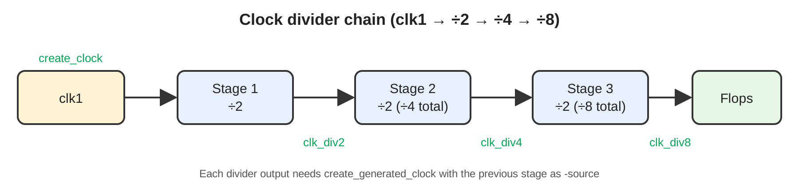

# Project 3: SDC Constraints and `check_timing` Cleanup

**Tool:** Synopsys Design Compiler | **Language:** Tcl / SDC

## Objective
Clear the `check_timing` warnings of a multi-stage clock-divider design by fixing its SDC.

## Design
Master clock `clk1` feeds stage 1 (divide by 2). Its output is the clock of stage 2 (divide by 2, so ÷4 total). The stage 2 output is the clock of stage 3 (divide by 2, so ÷8 total).



## Problem
`check_timing` reported warnings because the divider outputs were used as clocks without being defined as generated clocks.


## Solution
Define a generated clock (divide by 2) on each stage output, with the previous stage as its source, so the clock propagates through all three stages. All `check_timing` warnings were cleared.


## Repository Structure
```
project3_sdc_check_timing/
├── README.md
├── LICENSE
├── .gitignore
├── constraints/   before.sdc, after.sdc
├── scripts/       run_check_timing.tcl
├── rtl/
├── reports/
└── docs/          debug_notes.md, images/
```

## How to Run
```bash
DESIGN=<top_module> SDC=constraints/before.sdc dc_shell -f scripts/run_check_timing.tcl
DESIGN=<top_module> SDC=constraints/after.sdc  dc_shell -f scripts/run_check_timing.tcl
```

## Key Learnings
- A flop-divided clock is a new clock net and must be declared with `create_generated_clock`.
- Generated clocks in a chain are defined in order, each sourced from the previous stage.
- Run `check_timing` before synthesis or PnR.

## Author
**Gunti Siva Kumar**, B.Tech ECE, Narasaraopeta Engineering College (JNTUK)

## License
MIT
