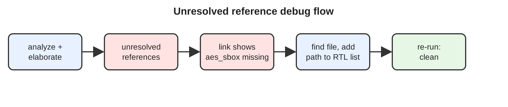

# Project 4: AES Cipher Top, Unresolved Reference Debug

**Tool:** Synopsys Design Compiler | **Language:** Tcl, Verilog RTL

## Objective
Bring up `aes_cipher_top` in Design Compiler. The project came with four RTL files, but one required module was missing. The goal was to find it and make `elaborate` and `link` run clean.

## Debug Flow


## Method 1: Fix the path in the main script
1. Start the shell and run the flow:
   ```tcl
   source scripts/aes.tcl
   ```
2. After `elaborate aes_cipher_top`, the tool reports **unresolved references**.

   
3. Run `link`. The output shows the missing module is **`aes_sbox`**.

   
4. Search for the missing RTL file.

   
5. Add its path to the RTL list in the script and run again.

   
6. `elaborate` and `link` now complete with the reference resolved.

   

## Method 2: Separate RTL list file
Keep the RTL file list in its own script and source it from the main flow.
1. Create `scripts/rtl.tcl` holding the RTL paths.

   
2. Source it. The same unresolved reference appears.

   
3. Find the missing RTL file.

   
4. Add the path to `rtl.tcl` and run again. The unresolved reference is gone.

   

## Repository Structure
```
project4_aes_cipher_top/
├── README.md
├── LICENSE
├── .gitignore
├── rtl/        # AES RTL files (.v), including aes_sbox
├── scripts/
│   ├── aes.tcl          # Method 1: self-contained flow
│   ├── rtl.tcl          # Method 2: RTL file list
│   └── aes_rtl_list.tcl # Method 2: flow that sources rtl.tcl
├── reports/
└── docs/       # debug_notes.md, images/
```

## How to Run
Libraries come from your own `.synopsys_dc.setup` (not committed).
```bash
dc_shell -f scripts/aes.tcl            # Method 1
dc_shell -f scripts/aes_rtl_list.tcl   # Method 2
```

## Key Learnings
- `elaborate` lists unresolved references, and `link` names the exact missing module.
- A missing sub-module such as `aes_sbox` means an RTL file is absent from the analyze list. Find it, add it, rerun.
- Keeping the RTL list in a separate Tcl file makes fixes like this a one-line change.

## Author
**Gunti Siva Kumar**, B.Tech ECE, Narasaraopeta Engineering College (JNTUK)

## License
MIT
